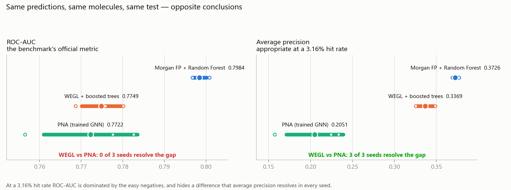
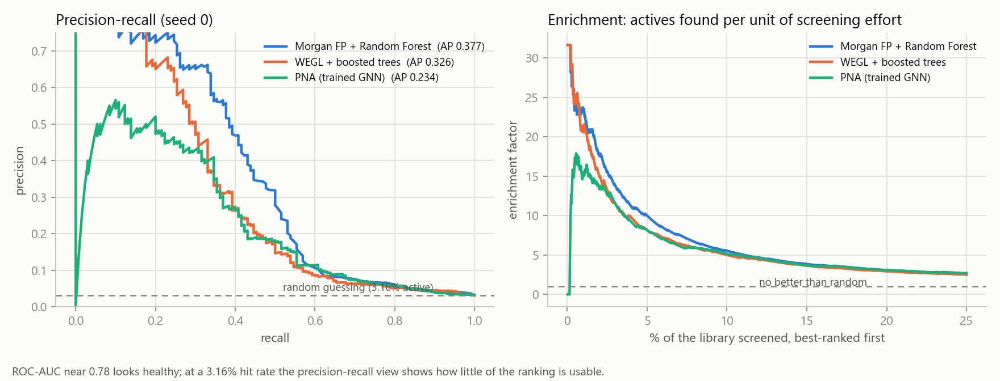
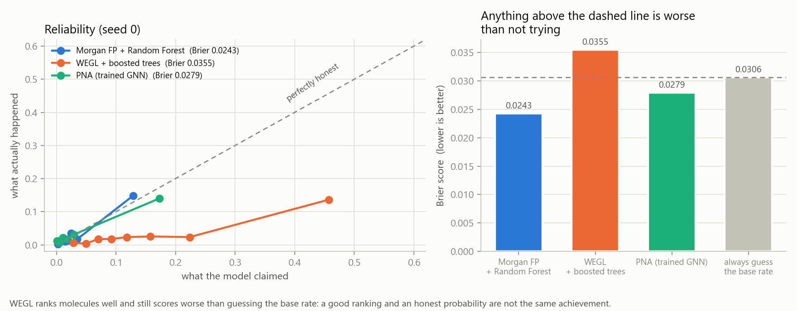
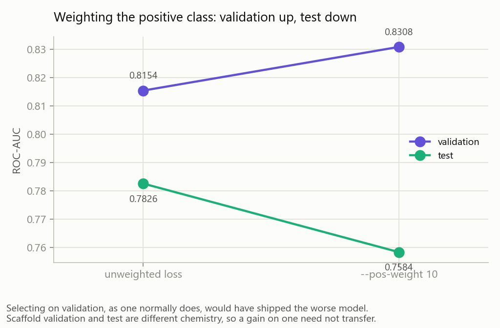

# The neural network lost to a checklist

I spent an hour of GPU time training a graph neural network — 715,441
parameters — to look at a molecule and predict whether it stops HIV from
replicating.

Then I tried the boring thing. Tick off which small chemical fragments appear in
the molecule, hand that checklist to a random forest, done in two minutes on a
laptop with nothing learned at all.

**The checklist won.**

That was the first surprise. The second one was bigger, and it's the reason this
repo exists: when I actually tested whether that win was real, **the benchmark
couldn't tell the two apart.** And when I swapped the scoring metric for one
that suited the problem, the whole ranking rearranged itself.

So this ended up being less a project about molecules and more a project about a
question I think a lot of us skip: **when you see a leaderboard, how do you know
the gaps on it mean anything?**

---

## What I was actually trying to find out


The dataset is `ogbg-molhiv` — 41,127 real molecules, each labelled with whether
it blocks HIV replication. About 3.5% of them do.

I wasn't trying to climb the leaderboard. People with far more compute have
done that, and squeezing out another decimal place wouldn't have taught me
anything. I wanted to know something simpler and, I think, more useful:

> If one model scores a bit higher than another, is that because it's better —
> or because it got lucky with which molecules landed in the test set?

To answer that you need models that are genuinely different from each other, and
statistics that are willing to come back and say *"actually, you can't tell."*

---

## The three contenders


Deliberately chosen to run from "learns nothing at all" to "learns everything
from scratch":

| | Approach | In plain words | Learns? |
|---|---|---|---|
| **Arm 1** | Morgan fingerprints + Random Forest | Make a checklist of which small chemical fragments are present. Let a forest of decision trees vote on it. | **No** |
| **Arm 2** | WEGL + Random Forest | Let each atom's description spread along its bonds a few times, then squash the whole molecule into one vector using a geometric trick. | **No** |
| **Arm 3** | PNA graph neural network | A real neural network, 715,441 parameters, trained end to end on a GPU. | **Yes** |

All three see **exactly the same molecules**, scored by the **same official
evaluator**, using the **same split**. No arm gets a quiet advantage.

### The sneaky part: how the molecules are split

The data is split by **scaffold** — the molecule's core skeleton. Every molecule
in the test set is built on a skeleton the model has never seen.

This matters more than it sounds. Split the molecules randomly and close
chemical cousins land on both sides; the model half-recognises the test set, and
every score comes out flattering. The scaffold split asks the harder question,
and the honest one: **does this still work on chemistry you've never met?**

---

## Round one: the scoreboard


4,113 test molecules, 130 of them active. Score is **ROC-AUC**, where 0.5 is
coin-flipping and 1.0 is perfect. Three random seeds each.

| Model | Score | Parameters learned | Hardware |
|---|---|---|---|
| 🥇 Morgan fingerprints + Random Forest | **0.7984** ± 0.0017 | none | CPU, minutes |
| 🥈 WEGL + boosted trees | **0.7749** ± 0.0047 | none | CPU, minutes |
| 🥉 PNA — the trained neural network | **0.7722** ± 0.0113 | 715,441 | GPU, ~12 min/seed |
| | WEGL + Random Forest | **0.7673** ± 0.0057 | none | CPU |

The neural network came **third of four**, behind two methods that don't learn
anything. It was also the twitchiest of the lot: run it with a different random
seed and it wandered by ±0.0113, more than six times as much as the humble
fingerprint baseline.


**How to read this.** Each row is one model, and the dot is its average score.
Behind it are two bars measuring two completely different things:

- The **thick short bar** — how much the score wobbled when I changed the random
  seed. This is the error bar you usually see in papers.
- The **thin long bar** — how much the score moves if the test set had been a
  slightly different draw of molecules. I rebuilt the test set 1,000 times to
  measure it.

Look at the difference in length. The thin bars are about **twenty times** the
thick ones. Which molecules happened to end up in the test set matters roughly
twenty times more than which seed you trained with — and that's the bar almost
nobody prints.

One more thing hiding in that picture: the two WEGL rows sit on **either side**
of the neural network. Those are the *same method*. The only difference is which
standard classifier is bolted on the end. That throwaway choice decides whether
a model that learns nothing finishes above or below a 715,441-parameter network.

---

## But is the scoreboard telling the truth?


Fingerprints beat the neural network by 0.026 — about fifteen times the
seed-to-seed wobble. Case closed, surely.

Not quite. All three models are graded on the *same* molecules, so a test set
that happens to contain a run of difficult molecules drags everyone down
together. To strip that out, I redraw the test set, score **both** models on
that same redraw, and write down the difference. A thousand times.


**How to read this.** Each panel is one head-to-head. The histogram is the 1,000
differences. The black line is zero — "no difference at all". When a serious
chunk of the histogram sits on *both* sides of that line, you haven't shown
anything.

| Match-up | Gap | Seeds where the gap holds up | Winner ahead in |
|---|---|---|---|
| Fingerprints vs WEGL | +0.0236 | **0 of 3** | 81–88% of redraws |
| Fingerprints vs PNA | +0.0262 | 1 of 3 | 79–98% of redraws |
| WEGL vs PNA | +0.0026 | **0 of 3** | 44–70% of redraws |

With only 130 active molecules to go on, this benchmark **cannot resolve
differences this small.** Fingerprints beat the neural network in 79–98% of
redrawn test sets — likely! — but "wins more often than not" and "is better" are
different claims, and the gap between those two sentences is basically the whole
project.

---

## The plot twist: the metric was hiding the answer


Everything above used ROC-AUC, because that's the official score for this
benchmark. But look at what ROC-AUC actually asks:

> *"Pick one active molecule and one inactive molecule at random. Did the model
> rank the active one higher?"*

With 3,983 inactive molecules and just 130 active ones, that question is
overwhelmingly about easy inactives every model already gets right. It's a
generous grader.

**Average precision** asks something you'd actually care about:

> *"Of the molecules you put at the very top of your list, how many were really
> active?"*

That's the question you ask when you can only afford to put a handful of
compounds into a lab. Same predictions, same molecules, same statistical test —
only the metric changes:



| | Fingerprints | WEGL | PNA |
|---|---|---|---|
| ROC-AUC | 0.7984 | 0.7749 | 0.7722 |
| Average precision | 0.3726 | 0.3369 | **0.2051** |

| WEGL vs PNA | Gap | Does it hold up? |
|---|---|---|
| under ROC-AUC | +0.0026 | **0 of 3 seeds** — a coin flip |
| under average precision | +0.1318 | **3 of 3 seeds** — ahead in 99.5%, 100%, 100% |

The comparison that was *"indistinguishable from a coin flip"* becomes
*"separated in every single seed and every single redraw."* Nothing about the
models changed. I changed the ruler.

Here's the same thing as a number you can feel. Say you can only afford to test
the top 1% of the library in a lab:



The fingerprint checklist finds about **30** of the 130 active molecules in that
top 1%. The trained neural network finds about **18**. That's a dozen real
compounds, hiding underneath a 0.026 gap in the headline number that the
official metric said was nothing.

**So the honest answer comes in two halves.** Judged by the metric this
benchmark officially uses, almost nothing separates the three models. Judged by
the metric that fits the actual problem, the trained neural network is clearly
the weakest of the three. The leaderboard only ever shows you the first half.

---

## Can you trust the number it hands you?


Ranking molecules well and being *honest about your confidence* turn out to be
two completely separate skills, and nothing on a leaderboard tells you about the
second one.

A model that says "0.45" should be right about 45% of the time. Here's what
actually happens:



**How to read this.** On the left, every point is a group of molecules. The
horizontal axis is what the model claimed; the vertical axis is what really
happened. The dashed diagonal is perfect honesty. Everything below it is
overconfidence.

All three lines sit well under the diagonal. **Every one of these models is
overconfident** — when they announce 45%, roughly 14% of those molecules are
genuinely active. If you took these numbers at face value to decide how many
compounds to order, you'd be disappointed about three times over.

The right-hand panel is sharper. WEGL *ranks* molecules perfectly respectably —
0.7749, second place on the scoreboard — and yet its probabilities score **worse
than a model that ignores the molecule entirely and always guesses 3.16%.**

It's a good reminder that "which model is best" isn't one question. It's at
least three: who ranks best, who's honest about it, and who you'd actually
deploy.

---

## What does all that complexity buy?


Worth putting the costs side by side, because this is the part the scoreboard
never shows:

| | Learned parameters | Hardware | Time | Avg. precision |
|---|---|---|---|---|
| Morgan fingerprints | **0** | laptop CPU | ~2 min | **0.3726** |
| WEGL | **0** | laptop CPU | ~3 min/seed | 0.3369 |
| PNA neural network | **715,441** | GPU | ~12 min/seed | 0.2051 |

An hour of GPU time and three quarters of a million parameters bought a model
that does the actual job — putting real actives at the top of the list — roughly
**half as well** as a fragment checklist that learns nothing.

Zoom out to the official leaderboard and the pattern holds in a way I found
genuinely startling. The entry at rank 9 scores 0.8208 using **5,782
parameters** — beating every graph network below it, including PNA's 326,081.
The entry at rank 1 spends **993 million** parameters to gain about 0.04 over
it.

That's not an argument against neural networks. It's an argument for asking what
the extra five orders of magnitude are actually for, and for always putting a
boring baseline on the chart.

---

## Do they at least find the *same* molecules?


Mostly, yes — and I had this wrong until I counted.

The three models order molecules quite differently (rank correlation only
0.31–0.38), so I assumed they must be catching *different* actives, and that
combining them would obviously help. That felt right. It wasn't.


**How to read this.** Every dot is a molecule, positioned by its rank under two
different models. The red dots are the actives — the ones we care about. If the
two models agreed, the red dots would line up along the diagonal.

Taking each model's own top 5%, out of 130 actives:

- **45** are found by all three models
- **59** are found by none of them
- All three together find **71**. The single best model alone finds **65**.

Three completely different approaches, and pooling them rescues **six extra
molecules**. They argue endlessly about how to order thousands of boring
inactives, and quietly agree on which molecules deserve a second look. Nearly
half the actives are invisible to everything.

I'm keeping this in the README precisely because my intuition was wrong and the
counting corrected it.

And that 59 is worth sitting with. Three genuinely different ways of looking at
a molecule — a chemical checklist, a geometric embedding, a trained network —
and **all three are blind to the same 59 molecules**. When methods this
different fail together, the limit probably isn't the method. It's more likely
the thing they all share: a flat, 2D picture of atoms and bonds, with no shape,
no charge, no conformation, and nothing about the assay the molecule was tested
in.

That reframes the whole comparison. I'd been asking which arm is best. The more
interesting question might be how much headroom any of them had to begin with.

---

## The molecules it got confidently wrong


Averages hide the thing a chemist would actually want to see, so the project
draws the molecules the model was most confidently wrong about.


Every one of these genuinely works against HIV. The model gave all six a
probability of **0.00**. Not uncertain — confidently, cheerfully wrong.

Two of them give the game away. Top right is a **cobalt complex**: a molecule
built around a metal atom. Bottom right is a **bis-pyridinium dication**, which
carries two permanent positive charges.

Neither a fragment checklist nor a 2D graph network copes with those, because
neither was designed with metal bonds or permanent charges in mind. The misses
also skew bigger and more ring-heavy (380 Da and 3.5 rings on average, against
277 Da and 2.8 rings for the molecules it wrongly flags).

That's not bad luck. It's a **systematic blind spot** — and a scaffold split is
exactly the thing that drags it into the open.

---

## The experiment that backfired (usefully)


Only 3.5% of these molecules are active, so the textbook move is to tell the
model to pay extra attention to the rare positives. I tried it.



Validation score went **up** by 0.015. Test score went **down** by 0.024.

If I'd done the normal thing — keep the model that looks best on validation — I
would have shipped the worse model, holding a number that looked like proof I
was right. On a scaffold split, the validation molecules and the test molecules
are *different chemistry*, so winning on one doesn't mean winning on the other.

It also turned out the weighting didn't just inflate the probabilities, as you'd
expect — it changed what the model actually learned. Rank correlation with the
unweighted model is only 0.52.

---

## Questions this left me with


Things I genuinely don't know, which feel more interesting than another
percentage point:

**How much of the leaderboard would reorder under a different metric?** If
switching from ROC-AUC to average precision can turn a coin flip into a decisive
3-of-3 result between two of my models, it would presumably do something to the
published rankings too. Nobody reports both.

**Are those 59 unreachable actives a chemistry problem or a representation
problem?** Three very different methods miss all of them. Finding out whether
they share a structural feature that a 2D graph simply cannot express — charges,
metals, conformation — would say more than any accuracy number.

**Is validation even the right thing to select on here?** The class-weighting
experiment moved validation and test in *opposite* directions. On a scaffold
split those two sets are different chemistry by construction, so "pick the best
validation score" may be a weaker habit than it looks.

**How much published work is sensitive to a library version?** Running identical
code on two machines shifted one arm by 0.0249 — about the size of the gaps
between my methods. I noticed it by accident. I'd like to know how common it is.

**What would honest error bars actually look like?** Mine treat test molecules
as independent, and scaffold-split molecules aren't. A proper scaffold-level
resampling would widen every interval here — I'd like to know by how much before
I trust any benchmark gap of this size again.

---

## Honest limitations


Three things I'd want a reader to know, because leaving them out would make this
look tidier than it is:

- My redraws treat test molecules as independent. They aren't — they cluster by
  scaffold — so the true margins are **wider** than I report. That makes the
  "you can't tell" conclusions stronger, not weaker.
- Running the identical code on two machines moved one arm's score by 0.0249,
  which is about as large as the gaps between the methods. I noticed it; I
  haven't explained it.
- Three seeds is few. The leaderboard convention is ten.

`DETAILS.md` has the rest.

---

## Try it yourself


```bash
pip install -r requirements.txt

python -m src.baseline_fp --seeds 0 1 2    # arm 1  (CPU, minutes)
python -m src.run_wegl    --seeds 0 1 2    # arm 2  (CPU, minutes)
python -m src.train       --seeds 0 1 2    # arm 3  (GPU)

python -m src.report       # the scoreboard
python -m src.compare      # ...but is it telling the truth?
python -m src.figures      # redraw every picture above
```

Or open `notebooks/colab_run.ipynb` and run the whole thing on a free Colab GPU.
The dataset ships inside this repo, so nothing is downloaded at run time.

Every figure above is rebuilt from the saved predictions in `results/`. You
don't have to retrain anything to reproduce them.

---

## What's in here


| File | What it does |
|---|---|
| `DETAILS.md` | The full technical write-up: methods, statistics, and what *isn't* proven |
| `REPRODUCE.md` | Exact software versions and where the data came from |
| `src/baseline_fp.py` | Arm 1 — the fingerprint checklist |
| `src/wegl.py`, `src/run_wegl.py` | Arm 2 — the graph embedding that learns nothing |
| `src/models.py`, `src/train.py` | Arm 3 — the PNA neural network |
| `src/report.py` | Builds the scoreboard, and checks every model really saw the same molecules |
| `src/compare.py` | The paired test — the part that's willing to say "you can't tell" |
| `src/figures.py` | Redraws every figure in this README |
| `src/error_analysis.py` | Draws the molecules the model got most wrong |
| `results/figures/` | Every picture above, regenerated from saved predictions |
| `app/main.py` | A small web API: send a molecule, get a prediction |
| `notebooks/colab_run.ipynb` | Runs the whole study end to end on a Colab GPU |

---

## Credits


Standing on a lot of open-source work:

- **[OGB](https://github.com/snap-stanford/ogb)** (MIT) — the dataset, the
  official scaffold split, the atom/bond encoders, the official evaluator.
- **[PyTorch Geometric](https://github.com/pyg-team/pytorch_geometric)** (MIT) —
  the `PNAConv` layer behind arm 3.
- **[PNA](https://github.com/lukecavabarrett/pna)** (Corso et al., NeurIPS 2020)
  — the architecture, and the published hyperparameters I started from.
- **WEGL** (Kolouri et al., ICLR 2021) — arm 2 is **reimplemented from the
  paper**, not copied from the authors' code, with two deviations documented in
  `DETAILS.md`.

The comparison itself, the WEGL reimplementation, the evaluation, the error
analysis, the figures and the serving layer were written for this project.
