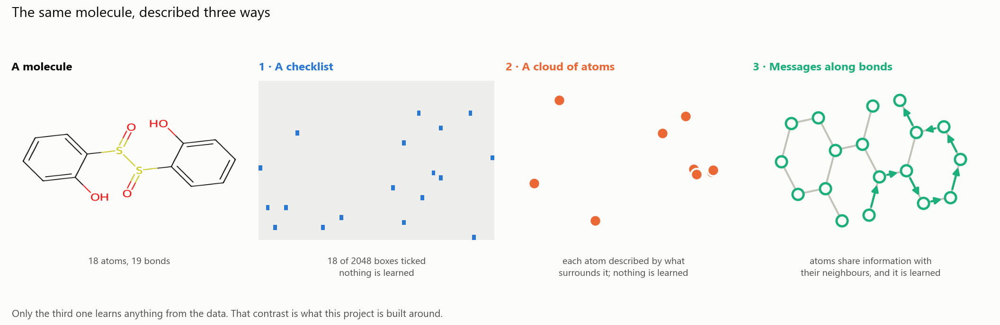
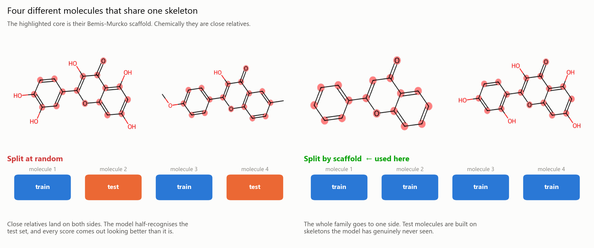
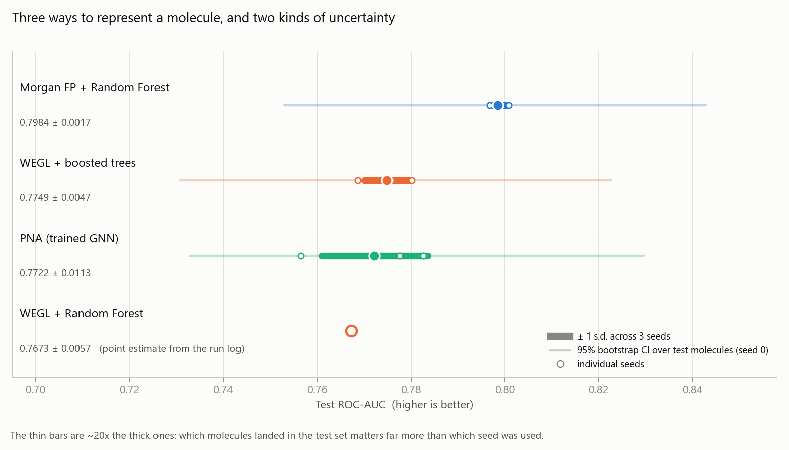
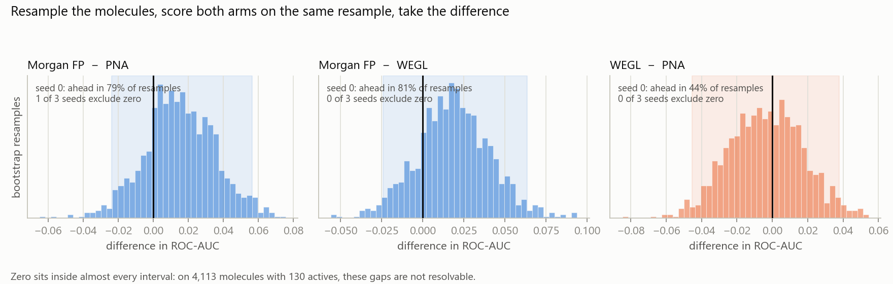
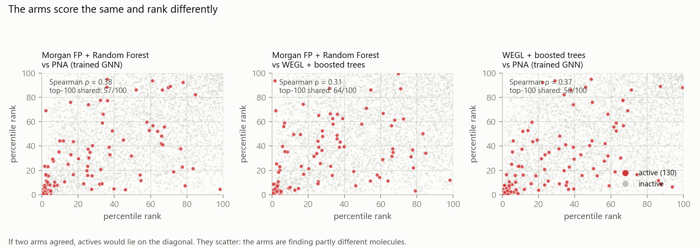
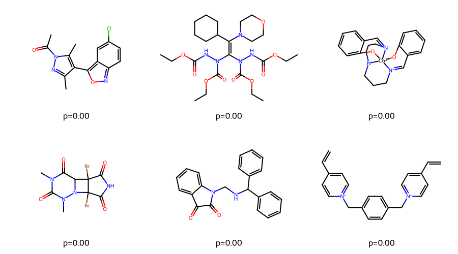

# When the simplest idea wins

I gave a graph neural network an hour of GPU time and 715,441 parameters, and
asked it to learn whether a molecule stops HIV from replicating.

Then I tried something almost embarrassingly simple: tick off which small
chemical fragments appear in the molecule, hand that list to a random forest.
Two minutes on a laptop. Nothing learned at all.

**The simple one came out ahead.**

That was the first surprise. The second one was better: when I checked *how
confident I should be* in that result, the benchmark turned out to have less to
say than it appeared. And when I measured the same models with a different
ruler, the whole ranking rearranged itself.

So this became less a project about molecules, and more about a question I think
we all skip past: **when you look at a leaderboard, what are those gaps actually
telling you?**

---

## What I set out to understand

The dataset is `ogbg-molhiv` — 41,127 real molecules, each labelled with whether
it blocks HIV replication. About 3.5% of them do.

I wasn't chasing the leaderboard. People with far more compute have already done
that, and another decimal place wouldn't have taught me much. I was after
something simpler:

> If one model scores a little higher than another, is that because it is
> genuinely better — or because it got a friendly draw of test molecules?

To answer that honestly you need models that differ in real ways, and statistics
willing to come back and say *"this one's too close to call."*

---

## Three ways to describe a molecule

Before any model can score a molecule, something has to turn it into numbers.
The three approaches here do that in genuinely different ways:



| | Approach | The idea | Learns from data? |
|---|---|---|---|
| **Arm 1** | Morgan fingerprints + Random Forest | Tick boxes for which chemical fragments are present, then let a forest of decision trees vote. | **No** |
| **Arm 2** | WEGL + Random Forest | Let each atom's description spread along its bonds a few times, then summarise the whole molecule as one vector using a geometric trick. | **No** |
| **Arm 3** | PNA graph neural network | Atoms pass messages to their neighbours through a network with 715,441 parameters, trained end to end. | **Yes** |

Only the third one learns anything. That contrast is the whole experiment — and
all three see **exactly the same molecules**, graded by the **same official
scorer**, on the **same split**.

---

## The part that makes it a fair test

Here's the detail that quietly decides everything. These molecules are split by
**scaffold** — their core skeleton — rather than at random.



Those four molecules are real neighbours from the dataset, built on one shared
core. Split the data randomly and close relatives like these end up on both
sides: the model recognises something familiar at test time, and every score
comes out looking generous.

A scaffold split sends the whole family to one side. Test molecules are built on
skeletons the model has genuinely never met — which is the question worth asking
if you want the result to mean anything outside the dataset.

---

## Round one: the scoreboard

4,113 test molecules, 130 of them active. The score is **ROC-AUC**, where 0.5 is
a coin toss and 1.0 is perfect. Three random seeds each.

| Model | Score | Learned parameters | Hardware |
|---|---|---|---|
| 🥇 Morgan fingerprints + Random Forest | **0.7984** ± 0.0017 | none | laptop CPU, minutes |
| 🥈 WEGL + boosted trees | **0.7749** ± 0.0047 | none | laptop CPU, minutes |
| 🥉 PNA — the trained network | **0.7722** ± 0.0113 | 715,441 | GPU, ~12 min/seed |
| | WEGL + Random Forest | **0.7673** ± 0.0057 | none | laptop CPU |

Two approaches that learn nothing came out above the trained network. It also
had the widest spread of the four: run it with a different random seed and it
moved by ±0.0113, more than six times as much as the fingerprint baseline.



**How to read this.** Each row is one model, and the dot is its average score.
Behind it sit two bars measuring quite different things:

- The **thick short bar** — how much the score shifted when I changed the random
  seed. This is the error bar you usually see quoted.
- The **thin long bar** — how much the score shifts if the test set had been a
  slightly different draw of molecules. I rebuilt the test set 1,000 times to
  measure it.

The thin bars run about **twenty times longer**. Which molecules happened to land
in the test set matters roughly twenty times more than which seed you trained
with — and it's the one that rarely gets printed.

There's a second thing hiding in that picture. The two WEGL rows sit on *either
side* of the neural network, and they are the **same method** — the only
difference is which standard classifier is attached at the end. A detail that
incidental decides whether something with zero learned parameters finishes above
or below a 715,441-parameter network. Worth holding onto.

---

## How sure can we be?

Fingerprints came out 0.026 ahead of the neural network — about fifteen times
the seed-to-seed movement. That feels settled.

It isn't quite. All three models are graded on the *same* molecules, so a test
set that happens to hold a run of difficult ones pulls everybody down together.
To separate that out, I redraw the test set, score **both** models on that same
redraw, and note the difference. A thousand times over.



**How to read this.** Each panel is one head-to-head. The histogram shows the
1,000 differences. The black line marks zero — "the same". When a good share of
the histogram sits on *both* sides of that line, the comparison is still open.

| Match-up | Gap | Seeds where it holds up | Leader ahead in |
|---|---|---|---|
| Fingerprints vs WEGL | +0.0236 | **0 of 3** | 81–88% of redraws |
| Fingerprints vs PNA | +0.0262 | 1 of 3 | 79–98% of redraws |
| WEGL vs PNA | +0.0026 | **0 of 3** | 44–70% of redraws |

With 130 active molecules to work from, this benchmark can only resolve so much.
Fingerprints came out ahead in 79–98% of redrawn test sets — a strong lean! —
but "ahead more often than not" and "better" are different claims, and the space
between those two sentences is really what this project is about.

---

## The plot twist: change the ruler, change the answer

Everything above used ROC-AUC, because that's the official score here. But look
at what ROC-AUC actually asks:

> *"Pick one active molecule and one inactive molecule at random. Did the model
> put the active one higher?"*

With 3,983 inactive molecules and 130 active ones, that question is mostly about
easy inactives every model already handles. It's a generous grader.

**Average precision** asks something closer to what you'd care about:

> *"Of the molecules you put at the very top of your list, how many turned out
> to be active?"*

That's the question you ask when you can only afford to put a handful of
compounds in front of a lab. Same predictions, same molecules, same statistical
test — only the ruler changes:


| | Fingerprints | WEGL | PNA |
|---|---|---|---|
| ROC-AUC | 0.7984 | 0.7749 | 0.7722 |
| Average precision | 0.3726 | 0.3369 | **0.2051** |

| WEGL vs PNA | Gap | Does it hold up? |
|---|---|---|
| under ROC-AUC | +0.0026 | **0 of 3 seeds** — too close to call |
| under average precision | +0.1318 | **3 of 3 seeds** — ahead in 99.5%, 100%, 100% |

A comparison that was *too close to call* becomes *clear in every single seed and
every single redraw*. Nothing about the models changed. I changed the ruler.

Here's the same thing as a number you can picture. Say you can afford to test
the top 1% of the library:


The fingerprint checklist surfaces about **30** of the 130 active molecules in
that top 1%. The trained network surfaces about **18**. That's a dozen real
compounds, sitting underneath a 0.026 gap the official metric treated as
nothing much.

**So the full answer comes in two halves.** By the metric this benchmark
officially uses, the three models sit close together. By the metric that fits
the actual task, they separate clearly, and the trained network sits lowest. A
leaderboard shows you the first half only.

---

## Can you trust the number it gives you?

Ranking molecules well and being *honest about your confidence* turn out to be
two separate skills, and leaderboards measure neither.

A model that says "0.45" should be right about 45% of the time. Here's what
happens:


**How to read this.** On the left, each point is a group of molecules: the
horizontal axis is what the model claimed, the vertical axis is what really
happened. The dashed diagonal is perfect honesty.

All three lines sit below that diagonal — **every one of these models is
overconfident.** When they announce 45%, about 14% of those molecules are
genuinely active. Take the numbers at face value when deciding how many
compounds to order, and you'd be let down roughly three times over.

The right-hand panel is sharper. WEGL *ranks* molecules perfectly respectably —
second place on the scoreboard — while its probabilities score further from the
truth than a model that ignores the molecule entirely and always answers 3.16%.

So "which model is best" isn't one question. It's at least three: who ranks
best, who's honest about it, and who you'd actually hand to someone.

---

## What all that complexity buys

Worth putting the costs side by side, because this part never makes it onto a
scoreboard:

| | Learned parameters | Hardware | Time | Avg. precision |
|---|---|---|---|---|
| Morgan fingerprints | **0** | laptop CPU | ~2 min | **0.3726** |
| WEGL | **0** | laptop CPU | ~3 min/seed | 0.3369 |
| PNA neural network | **715,441** | GPU | ~12 min/seed | 0.2051 |

An hour of GPU time and three-quarters of a million parameters produced a model
that does the real job — putting genuine actives at the top of the list — around
half as effectively as a fragment checklist that learns nothing.

Zoom out to the official leaderboard and the same shape appears, which I found
genuinely striking. The entry at rank 9 reaches 0.8208 using **5,782
parameters** — ahead of every graph network below it, PNA's 326,081 included.
The entry at rank 1 spends **993 million** parameters to gain about 0.04 over
it.

None of that is an argument against neural networks. It's an argument for asking
what the extra five orders of magnitude are buying, and for always putting a
simple baseline on the same chart.

---

## Do they find the *same* molecules?

Mostly, yes — and I had this the wrong way round until I counted.

The three models order molecules quite differently (rank correlation just
0.31–0.38), so I assumed they must be catching *different* actives, and that
pooling them would obviously help. It felt right. The counting disagreed.



**How to read this.** Every dot is a molecule, placed by its rank under two
different models. The red dots are the actives. If the two models agreed, the
red dots would line up along the diagonal.

Taking each model's own top 5%, out of 130 actives:

- **45** are surfaced by all three models
- **59** are surfaced by none of them
- All three together surface **71**. The single best model alone surfaces **65**.

Three very different approaches, and pooling them adds **six molecules**. They
argue at length about how to order thousands of unremarkable inactives, and
quietly agree on which ones deserve a closer look.

That 59 is the part worth sitting with. Three genuinely different ways of
looking at a molecule, and the same 59 stay out of reach of all of them. When
methods this different run into the same wall, the wall probably isn't the
method — it's more likely the thing they all share: a flat, 2D picture of atoms
and bonds, with no shape, no charge, no conformation, and nothing about the
experiment the molecule was tested in.

Which reframes the whole exercise. I'd been asking which arm comes out on top.
The better question may be how much headroom any of them had.

---

## The molecules that slipped through

Averages hide the thing a chemist would actually want to see, so the project
draws the ones the model felt most certain about and still missed.



Every one of these genuinely works against HIV. The model gave all six a
probability of **0.00** — not hesitant, but certain.

Two of them explain the pattern. Top right is a **cobalt complex**, built around
a metal atom. Bottom right is a **bis-pyridinium dication**, carrying two
permanent positive charges.

Neither a fragment checklist nor a 2D graph network has much to say about
those, because neither was designed with metal bonds or permanent charges in
mind. The missed molecules also skew larger and more ring-heavy (380 Da and 3.5
rings on average, against 277 Da and 2.8 rings for the ones it over-calls).

That's a pattern, not bad luck — and a scaffold split is exactly what brings it
into view.

---

## What class weighting taught me

Only 3.5% of these molecules are active, so the textbook move is to tell the
model to pay extra attention to the rare positives. I tried it.


The validation score went **up** by 0.015. The test score went **down** by
0.024.

Had I done the usual thing — keep whichever model looks best on validation — I'd
have chosen the weaker one while holding a number that looked like support for
it. On a scaffold split, the validation molecules and the test molecules are
*different chemistry*, so a gain on one needn't carry across.

It also turned out the weighting didn't simply inflate the probabilities, which
is what you'd expect. It changed what the model learned: rank correlation with
the unweighted version is only 0.52.

---

## Questions I'm still turning over

The things I don't know yet, which feel more interesting than another decimal
place:

**How much of a published leaderboard would reorder under a different metric?**
If switching from ROC-AUC to average precision can turn "too close to call" into
a clear 3-of-3 result between two of my models, it presumably does something to
the published rankings too. Both are rarely reported together.

**Are those 59 out-of-reach actives a chemistry story or a representation
story?** Three very different methods miss all of them. Finding out whether they
share a structural feature a 2D graph simply can't express — charge, metals,
conformation — would say more than any accuracy number.

**Is validation the right thing to select on here?** The class-weighting
experiment moved validation and test in opposite directions. On a scaffold split
those two sets are different chemistry by construction, so "keep the best
validation score" may be a weaker habit than it looks.

**How sensitive is published work to a library version?** Running identical code
on two machines shifted one arm by 0.0249 — about the size of the gaps between
my methods. I found it by accident, and I'd like to know how common it is.

**What would fully honest error bars look like?** Mine treat test molecules as
independent, and scaffold-split molecules aren't. Proper scaffold-level
resampling would widen every interval here.

---

## The honest scope of these numbers

Three things a reader deserves up front, because leaving them out would make
this look tidier than it is:

- My redraws treat test molecules as independent. They cluster by scaffold, so
  the true margins are **wider** than I report — which makes the "too close to
  call" conclusions firmer, not shakier.
- Running the identical code on two machines moved one arm's score by 0.0249,
  comparable to the gaps between methods. I spotted it; I haven't explained it.
- Three seeds is few. The leaderboard convention is ten.

`DETAILS.md` covers the rest.

---

## Try it yourself

```bash
pip install -r requirements.txt

python -m src.baseline_fp --seeds 0 1 2    # arm 1  (CPU, minutes)
python -m src.run_wegl    --seeds 0 1 2    # arm 2  (CPU, minutes)
python -m src.train       --seeds 0 1 2    # arm 3  (GPU)

python -m src.report       # the scoreboard
python -m src.compare      # how sure can we be?
python -m src.figures      # redraw every chart above
python -m src.diagrams     # redraw the two explainers
```

Or open `notebooks/colab_run.ipynb` and run the whole thing on a free Colab GPU.
The dataset travels inside this repo, so nothing is downloaded at run time.

Every picture above is rebuilt from the saved predictions in `results/` — no
retraining needed to reproduce them.

---

## What's in here

| File | What it does |
|---|---|
| `DETAILS.md` | The full technical write-up: methods, statistics, and what each figure shows |
| `REPRODUCE.md` | Exact software versions and where the data came from |
| `src/baseline_fp.py` | Arm 1 — the fingerprint checklist |
| `src/wegl.py`, `src/run_wegl.py` | Arm 2 — the graph embedding that learns nothing |
| `src/models.py`, `src/train.py` | Arm 3 — the PNA neural network |
| `src/report.py` | Builds the scoreboard, and checks every model saw the same molecules |
| `src/compare.py` | The paired test — the part willing to say "too close to call" |
| `src/figures.py` | Redraws every chart in this README |
| `src/diagrams.py` | Redraws the two explainer diagrams, from real dataset molecules |
| `src/error_analysis.py` | Draws the molecules the model missed most confidently |
| `app/main.py` | A small web API: send a molecule, get a prediction |
| `notebooks/colab_run.ipynb` | Runs the whole study end to end on a Colab GPU |

---

## Credits

Standing on a lot of open-source work:

- **[OGB](https://github.com/snap-stanford/ogb)** (MIT) — the dataset, the
  official scaffold split, the atom/bond encoders, the official evaluator.
- **[PyTorch Geometric](https://github.com/pyg-team/pytorch_geometric)** (MIT) —
  the `PNAConv` layer behind arm 3.
- **[PNA](https://github.com/lukecavabarrett/pna)** (Corso et al., NeurIPS 2020)
  — the architecture, and the published hyperparameters I started from.
- **WEGL** (Kolouri et al., ICLR 2021) — arm 2 is **reimplemented from the
  paper**, not copied from the authors' code, with two deviations documented in
  `DETAILS.md`.

Every figure in this README is drawn from this project's own runs. The
comparison, the WEGL reimplementation, the evaluation, the error analysis, the
diagrams and the serving layer were written for it.
